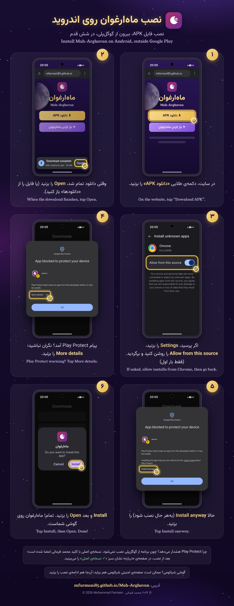
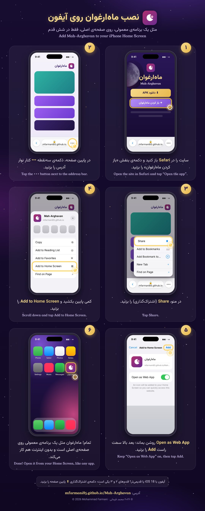

# Mah-Arghavan · ماه‌ارغوان

**English for Farsi speakers, from A1 to C2 · آموزش انگلیسی برای فارسی‌زبانان، از A1 تا C2**
**Creator and copyright owner: Mohammad Farmani (محمد فرمانی)**

Copyright © 2026 Mohammad Farmani. All rights reserved.

**Website: https://mfarmani85.github.io/Mah-Arghavan/**

Mah-Arghavan is a complete English course for Farsi speakers: 6,000+ words, 48 grammar lessons, pronunciation, a library of stories and songs, and IELTS practice with full mock tests. Profiles are password-protected, progress stays on your device, and it works fully offline.

## Android

Install the official app from [`Mah-Arghavan.apk`](Mah-Arghavan.apk) (version 1.5.0, Android 7.0 or newer, built for Android 16):

1. Download the APK and tap **Open** when the download finishes.
2. If asked, turn on **Allow from this source** for your browser (first time only).
3. If Google Play Protect shows "App blocked to protect your device", tap **More details**, then **Install anyway**. It only warns because the app is installed from outside Google Play.
4. Tap **Install**, then **Open**.

If you have an older version installed: the signing key changed in 1.5.0, so first use **Backup** in the app, uninstall the old version, install 1.5.0, then **Restore**.

For spoken English, install an English voice: Settings → System → Text-to-speech → Google Speech Services → Install voice data → English.

## iPhone

1. Open **https://mfarmani85.github.io/Mah-Arghavan/app/** in **Safari**.
2. Tap the **•••** button next to the address bar, then **Share**. (iOS 18 or older: tap the **Share** button at the bottom of the screen.)
3. Scroll down and tap **Add to Home Screen**.
4. Keep **Open as Web App** on and tap **Add**.
5. Open Mah-Arghavan from your Home Screen. After the first launch it works offline; the songs download in the background the first time (about 34 MB).

The daily reminder is available in the Android app only. Progress stays on the device, so use **Backup** in Settings from time to time.

## Is my copy official?

The official Android app is signed by Mohammad Farmani. On the app's About page, the official copy shows a green badge: «✓ نسخه‌ی اصلی، امضاشده با کلید محمد فرمانی». A copy that has been modified or re-signed by anyone else shows a warning instead. Download only from this repository or its website.

| Check | Official value |
|---|---|
| Signer | CN=Mohammad Farmani, OU=Mah-Arghavan, O=Mohammad Farmani |
| Signing certificate SHA-256 | `9b2b8cab2730c9be150d77bd9d176cc2a6fc38009cab2123c8f8a4f14e876080` |
| Mah-Arghavan.apk SHA-256 (v1.5.0) | `def7cf3b29258ddb6089c5e2165491f45a8b874e41be21f2ec48a4ca2c044e9c` |

## Copyright and license

Mah-Arghavan, including its source code, apps, texts, poems, lyrics, music, artwork, vocabulary and exercise content, name, icon and design, is the exclusive property of **Mohammad Farmani**.

This is **not** open-source software, and its source code is private. The files here are compiled, minified builds. You may use the official apps for personal use, but you may not copy, modify, redistribute, rebrand, re-sign, host or publish Mah-Arghavan or any part of it without written permission from Mohammad Farmani. Forking this repository does not grant any rights. See [LICENSE](LICENSE) for the full terms.

---

✦ Created in loving memory of Solmaz, my one & only Star in the Milky Galaxy.
